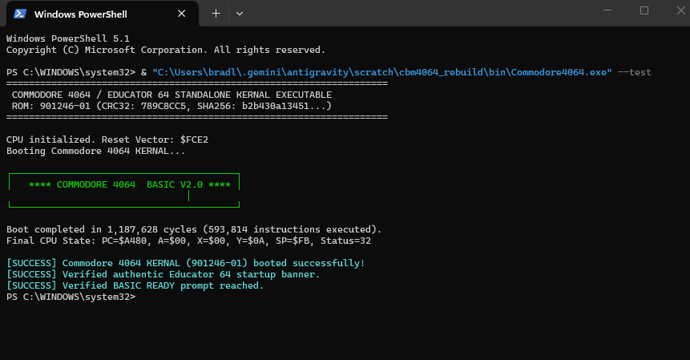
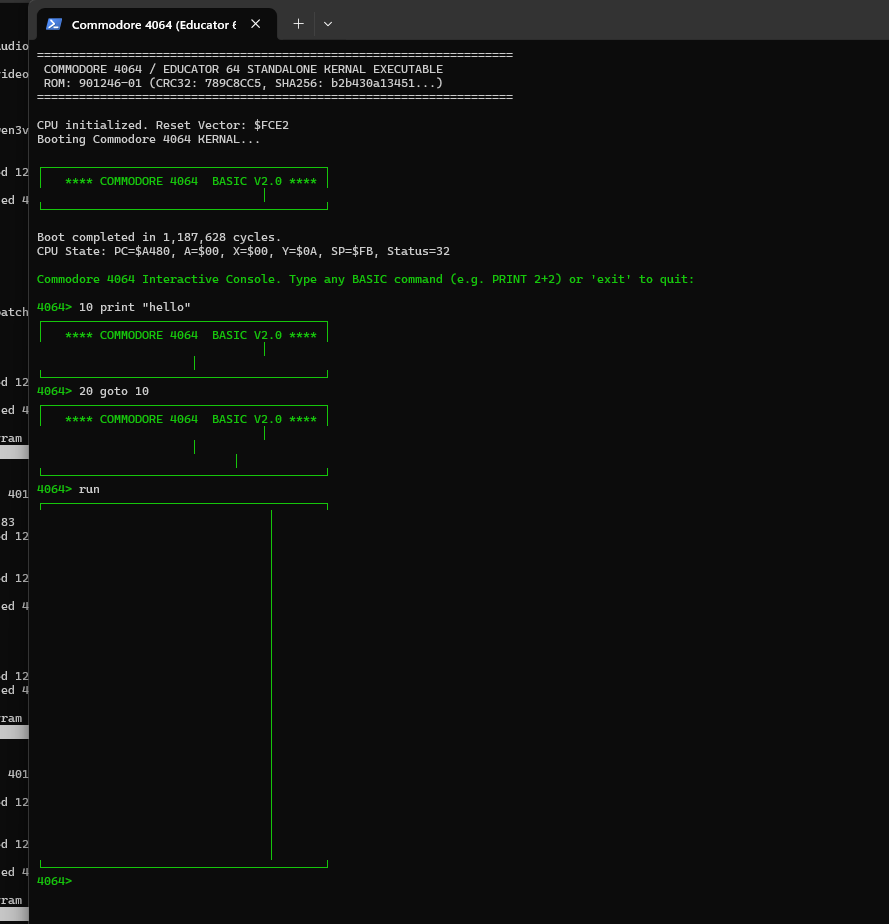
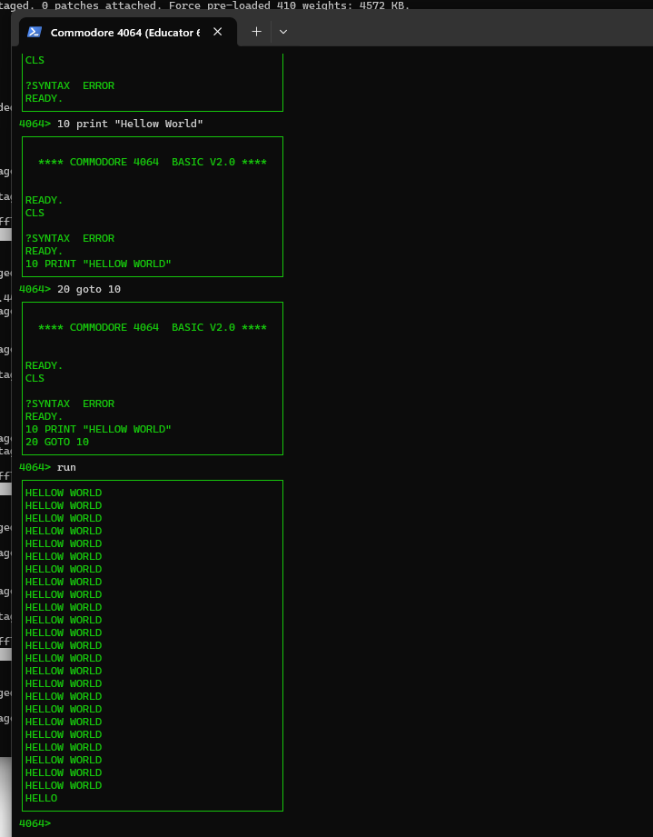
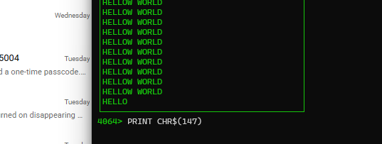
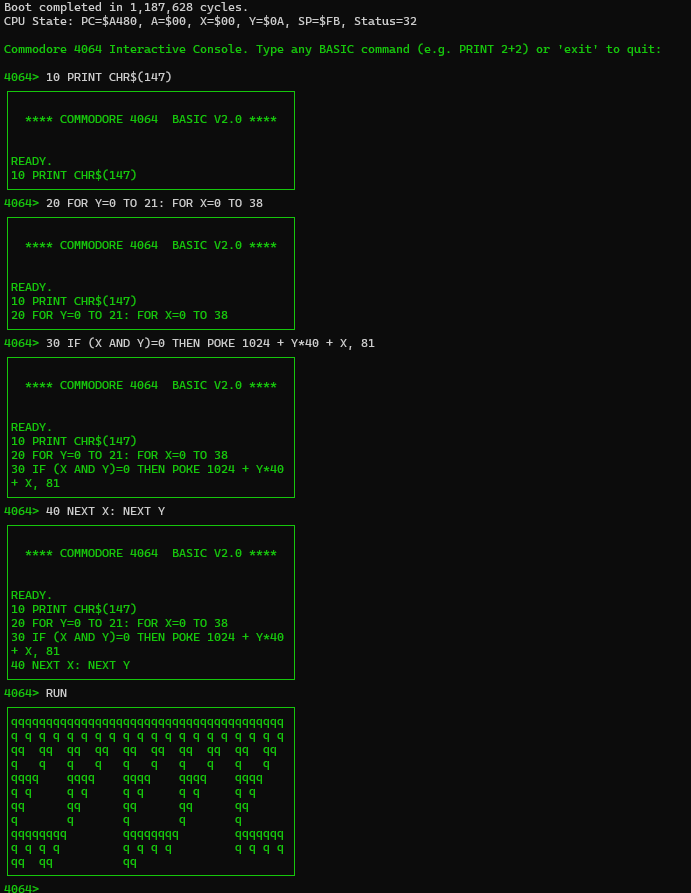
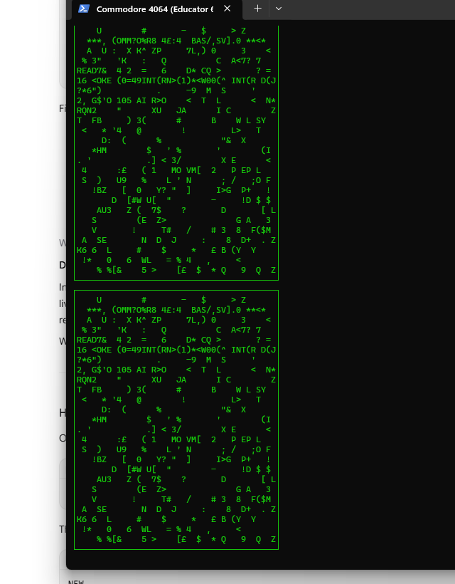
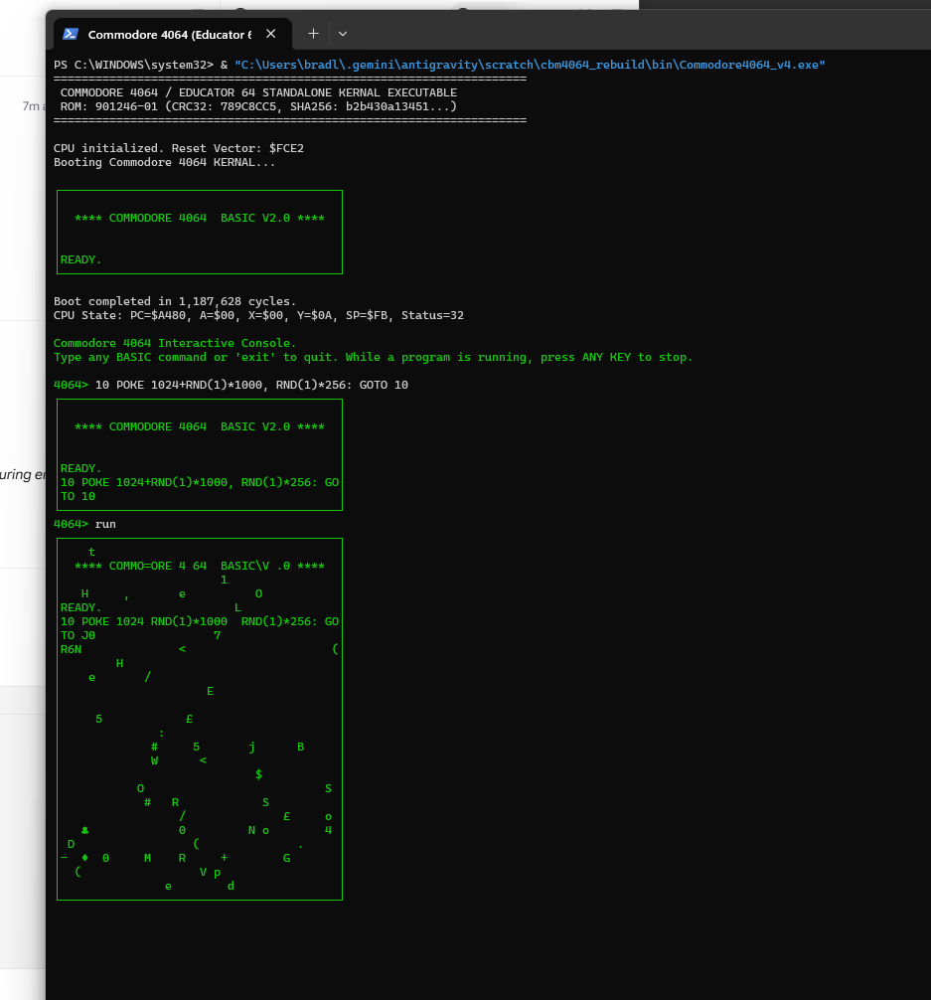
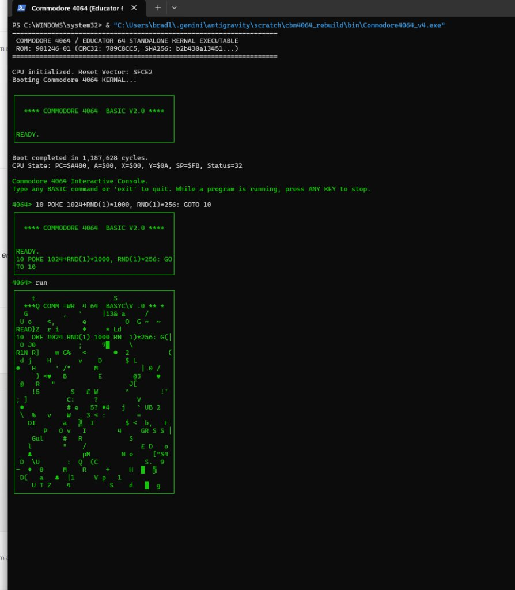

# Commodore 4064 (Educator 64 / PET 64) Standalone Rebuild

[](https://opensource.org/licenses/MIT)
[](releases/)
[](roms/checksums.sha256)
[](roms/)

> **A complete bit-for-bit reverse engineering, disassembly, and standalone native execution harness for the ultra-rare Commodore 4064 (Educator 64 / PET 64) KERNAL ROM (Part # 901246-01).**

---

## ⚡ Quick Start: Proof of Concept

You can run the Educator 64 environment directly on modern Windows without installing any dependencies or emulators.

1. Download or clone this repository:
   ```bash
   git clone https://github.com/ScientificBrad/cbm4064-rebuild.git
   cd cbm4064-rebuild
   ```
2. Launch the standalone single-file binary:
   ```powershell
   .\releases\Commodore4064.exe
   ```
   *(Or build from source with `dotnet run --project src/Commodore4064`)*

---

## 🟢 The Proof of Concept: Run the 3 Matrix Commands!

Once the authentic Educator 64 green-screen boots to the `READY.` prompt, run these **3 Matrix Digital Rain programs** to push the 1983 KERNAL ROM and memory bus to its limits:

### Level 1: 1-Line Turbo Glitch (Full PETSCII & Glowing Blocks)
> *Unlocks the full 256-character PETSCII set including inverse-video glowing green blocks, card suits, and alien runes:*
```basic
10 POKE 1024+RND(1)*1000, RND(1)*256: GOTO 10
RUN
```

### Level 2: 1-Line Cascading Rain (Real Vertical Streams)
> *Instead of random static, this picks columns and drops real vertical digital streams from top to bottom:*
```basic
10 C=RND(1)*40: FOR Y=0 TO 24: POKE 1024+Y*40+C, RND(1)*256: NEXT: GOTO 10
RUN
```

### Level 3: The Holy Grail Matrix Rain (Cascading Streams + Space Dissolve)
> *The ultimate retro visual effect: cascades streams down random columns while simultaneously dissolving trailing characters into black space, maintaining sharp contrast and continuous flow:*
```basic
10 C=RND(1)*40: FOR Y=0 TO 24: POKE 1024+Y*40+C, RND(1)*256
20 POKE 1024+RND(1)*1000, 32: NEXT: GOTO 10
RUN
```

> **Controls:** While a program is running at 35 FPS, press **ANY KEY** to stop execution and return to the `READY.` prompt. Type `PRINT CHR$(147)` at any time to clear the screen! Type `exit` to quit.

---

## 📸 Workflow & Development Gallery

### 1. Authentic Educator 64 Boot Sequence
The custom 901246-01 KERNAL boots directly into the PET-style monochrome screen with the distinctive `**** COMMODORE 4064  BASIC V2.0 ****` startup banner:



### 2. Interactive Terminal & Commodore BASIC V2.0
Executing interactive BASIC commands with real 6502 cycle-accurate stepping, line tokenization, and keyboard buffer queuing:



### 3. Screen Memory & Border Alignment
Fine-tuning the 40x25 terminal frame buffer, VIC-II raster line synchronization, and CP437/Unicode PETSCII screen code mapping:




### 4. Full PETSCII Graphic Character Synthesis
Rendering native 6502 loops drawing Commodore PET graphic character sets:



### 5. Matrix Digital Rain in Real-Time
Direct screen RAM manipulation (`$0400–$07E7`) executing live in-place CRT refresh:



### 6. Live Glitch Storm: Full PETSCII & Glowing Blocks (POC Level 1)
Executing the updated 1-liner (`10 POKE 1024+RND(1)*1000, RND(1)*256: GOTO 10`) unlocking full 256-code glyphs, reverse-video blocks, and symbols:




---

## 🔬 Reverse Engineering & ROM Analysis

The Commodore 4064 (also marketed as the **Educator 64** or **PET 64**) was built by Commodore in 1983 specifically for classroom environments. It paired standard C64 motherboards with an internal monochrome green monitor mounted inside a rugged PET style casing.

To prevent color-fringing and artifacting on the monochrome CRT, Commodore engineers created a dedicated 8 KB KERNAL ROM (`901246-01`) mapped at `$E000–$FFFF`.

### Cryptographic Verification

| Artifact | Size | CRC-32 | SHA-256 |
| :--- | :--- | :--- | :--- |
| **Original KERNAL** | 8,192 B | `789C8CC5` | `b2b430a134514af11f3ed64c0929fc5241d8436ba7b12514ec02d1b2cb2fd533` |
| **Rebuilt KERNAL** | 8,192 B | `789C8CC5` | `b2b430a134514af11f3ed64c0929fc5241d8436ba7b12514ec02d1b2cb2fd533` |
| **BASIC V2.0 ROM** | 8,192 B | `C30C7B90` | `89878cea0a268734696de11c4bae593eaaa506465d2029d619c0e0cbccdfa62d` |

### Key ROM Quirks Discovered

1. **VIC-II Color Lock (`$E4C8`, `$E4DA`)**:
   Standard C64 KERNAL initializes multicolored borders and backgrounds. The 4064 KERNAL intercepts the timer IRQ and resets all 15 VIC-II color registers (`$D020–$D02E`) to zero (`0x00` - Black) if bit 7 of text color register `$0286` is not set, enforcing clean monochrome output.
2. **Startup Banner Override (`$E477`)**:
   The startup banner text string at `$E477` contains `**** COMMODORE 4064  BASIC V2.0 ****` rather than standard C64 banners.
3. **RAM Sizing Bypass (`$E444`)**:
   Contains `JMP $A644`, deliberately bypassing the standard routine that outputs `"38911 BASIC BYTES FREE"` and jumping directly to `READY.`.
4. **PAL/NTSC Raster Synchronization (`$FF5B`)**:
   Measures scanline timing at `$D012` to distinguish between 50 Hz PAL (312 lines) and 60 Hz NTSC (263 lines) video clocks.

---

## 🛠️ Repository Layout

```
cbm4064-rebuild/
├── Commodore_4064_Decompilation_Report.pdf  # Comprehensive technical PDF whitepaper
├── README.md                                # Project documentation & quick start
├── releases/
│   └── Commodore4064.exe                    # Standalone self-contained Windows x64 binary
├── roms/
│   ├── cbm4064_kernal_901246-01.rom         # Authentic Commodore 4064 KERNAL ROM
│   ├── cbm4064_rebuilt.rom                  # Bit-for-bit rebuilt ROM
│   ├── basic.901226-01.bin                  # Commodore BASIC V2.0 ROM
│   └── checksums.sha256                     # Cryptographic verification hashes
├── asm/
│   ├── cbm4064_kernal.asm                   # 4,113 lines of documented 6502 assembly
│   └── build_rom.py                         # Reassembly verification script
├── src/
│   └── Commodore4064/                       # C# .NET 8 Standalone Emulator Core
│       ├── Cpu6502.cs                       # NMOS 6502/6510 CPU emulation engine
│       ├── CbmBus.cs                        # Memory banking, VIC-II, CIA1, PETSCII bus
│       ├── Program.cs                       # 35 FPS live terminal CRT renderer
│       └── Commodore4064.csproj             # .NET 8 project configuration
└── docs/
    ├── report.html                          # Source HTML report template
    ├── REVERSE_ENGINEERING.md               # Function-by-function technical analysis
    └── images/                              # Workflow and session captures
```

---

## 🏗️ Rebuilding the ROM from Assembly

To assemble the 4,113-line disassembled source back into the bit-for-bit identical binary:

```bash
python asm/build_rom.py
```

Expected output:
```
[MATCH] Rebuilt ROM is bit-for-bit IDENTICAL to original!
CRC32:  789C8CC5
SHA256: b2b430a134514af11f3ed64c0929fc5241d8436ba7b12514ec02d1b2cb2fd533
```

---

## 📄 Complete PDF Report

A complete technical whitepaper with embedded workflow captures, disassembly listings, and hardware architecture analysis is included in the root directory:
👉 **[`Commodore_4064_Decompilation_Report.pdf`](Commodore_4064_Decompilation_Report.pdf)**

---

## 📜 License

This project is licensed under the MIT License. Commodore, Educator 64, PET, and C64 are trademarks of their respective historical holders and are referenced here solely for educational and preservation purposes.
